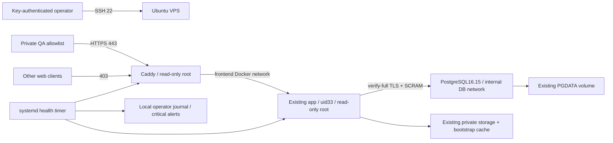

# ONE TALIBON VPS architecture — implemented baseline

Engineer KIRCH accountable; Codex sole executor. Authority [7238940453](https://github.com/Project-Intra-Smithy/engineering-hub/issues/197#issuecomment-7238940453), paired6f30f2b0/7238945386; compatibility fallback7238915276 and paired START7239081344/f74f790d/7239089932. OperationForge0e8765de and Ponytail full. This is the existing srv2146360 only, not a new deployed environment or municipal release.

## Actual topology

Only Caddy publishes80/443 TCP and443 UDP. App/database ports are unexposed. Caddy and app share the existing frontend network; only app and DB join the new internal `one-talibon_database` network. DB no longer joins the frontend network. No Docker socket is mounted in a service. Docker forwarding is Docker-managed; UFW is not falsely claimed to filter published container traffic. Caddy itself enforces the QA allowlist using the actual remote peer, not untrusted forwarded headers.

The host is Ubuntu26.04.1 LTS, kernel7.0.0-38,4 CPUs,16GB RAM,193GB filesystem, about179GB available at initial inventory. Existing encrypted `/srv/kirjane`, Hostinger/Monarx services, chrony, retained databases and volumes were left intact. Existing daily unattended security-update policy retained. A pre-existing reboot-required marker remains an explicitly scheduled maintenance item; no major upgrade or reboot performed.

## Implemented controls and checks

| Surface | Actual result |
|---|---|
| SSH | Existing keys retained; root password and keyboard-interactive login disabled; root key login retained; syntax/effective-policy checks and fresh key session passed. |
| Firewall | UFW active, default deny incoming, allow22/tcp,80/tcp,443/tcp+udp for IPv4/IPv6. No additional listeners introduced. |
| Proxy | Stable `/opt/devtestportal/infra/Caddyfile`; pinned existing Caddy digest; no application or DB secrets in proxy environment; read-only root, no-new-privileges, only NET_BIND_SERVICE capability, bounded logs/resources. |
| QA ingress | Allowlisted external HTTPS/login200 with verified certificate; separate nonallowlisted container request403.25MB request-body cap and bounded upstream timeouts. Allowlist values remain private. |
| Restart | Caddy process termination inside the container caused automatic engine restart and successful HTTPS recovery. An API-level docker kill test first suppressed restart; service was immediately started and the correct process-failure test then passed. |
| PostgreSQL | Same stock16.15 image and PGDATA volume, TLS1.2+ with operator private CA, SCRAM for socket/TCP and explicit rejection of plaintext TCP. Verified-TLS bootstrap authentication passed. |
| Provisioning logging | Existing offline bootstrap identity one_talibon_app receives role-scoped panic/0 defaults. Runtime connection still reports global error/-1 defaults. Global SQL monitoring/preload settings and host scanner were not weakened. |
| Web runtime | Same existing source image, uid33, read-only root; writable existing document/session storage and separate bootstrap cache; tmpfs Apache runtime directories; no-new-privileges; actual DB ssl=true and sslmode=verify-full, secure cookie=true/debug=false, health probe healthy. |
| Resource limits | App2CPU/2GiB/256PIDs, DB2CPU/4GiB/256PIDs, Caddy1CPU/256MiB/128PIDs; no host swap required by current headroom. Limits are ceilings, not reserved capacity. |
| Logs/health | Per-container json-file10MiB x3; minute systemd check covers service health, published-port invariant, TLS/login, runtime DB TLS, certificate renewal, disk and memory pressure. Critical issues go to local daemon.crit journal and failed service state; external on-call delivery remains a production gate. |
| Preservation | Before/after in-memory digests across DB reconfiguration matched cluster identity, ledger, all users/employees/departments and restrictive defaults. App key and runtime DB password bytes compared unchanged across web recreation. No secret fingerprints published. |

Material DB transport/authentication changes were first exercised in a new guarded16.15 synthetic tmpfs container with network=none/no ports, no actual target data. Verified TLS/SCRAM succeeded; wrong password and plaintext TCP refused; bootstrap-role logging worked without changing the original global value. Container stopped/removed and synthetic input removed by its finally block. This was a CLI/config rehearsal, not another deployed application instance.

Actual configuration is [versioned here](config/compose.json), with private env-file references only. [As-built observations](config/as-built.json) identify the active image/mount/network/resource state. `Caddyfile.example` is deliberately redacted and must receive approved private addresses before use. See [operations](OPERATIONS.md), [release/cutover](RELEASE.md), and [production recovery gate](RECOVERY.md).

## Source and remaining release gate

Active application remains the pre-existing release `bf097d746836ef25a5988bfb081d22bb80122660`, image sha256:c3b1a3ea74f104ee7cb83d287fbf82773898fa0b65ed4946a92dd72ca3b9b062. Directory/image provenance is observed; full old-source Git-tree attestation is not awarded. The new application is not deployed.

Consolidated read-only admission on accepted PR82 oracle: exact canonical54 ledger; all8 stock security sections equal; all41 unsupported families absent; no unknown legacy objects/owners/grantees/routine definitions, role collisions, startup drift or retired runtime ownership. Two owner-only global routine defaults remain, intentionally unchanged. Infrastructure cannot erase these without changing policy. [Draft PR83](https://github.com/Project-Intra-Smithy/ONE-TALIBON-intra.office.system-STABLE-v1-10-18-2026/pull/83) implements only the authorized compatibility delta, preserving frozen PR82/Nox6097530717. Candidate qualification and targeted independent delta acceptance/final disposition precede any live schema installation. This is not a general security review or application requalification.

Kirjane was selected privately by the unique exact normalized owner alias, active system_admin status and linked employee/office. MFA decrypts and remains confirmed. The retained synthetic password does not match; no login attempt, reset, re-enrollment or credential substitution made. Engineer has agreed to private browser sign-in. Existing user cleanup remains0 physically removed/0 newly deactivated; no source-deployment, fixture-population, evaluator-access or multi-role smoke PASS is claimed.

No backup/snapshot/dump/reset, forced cascades, audit rewriting, extra deployed stack, unrelated-service change, main merge/public launch or Siris activation. No municipal production readiness or mission CLOSE.
