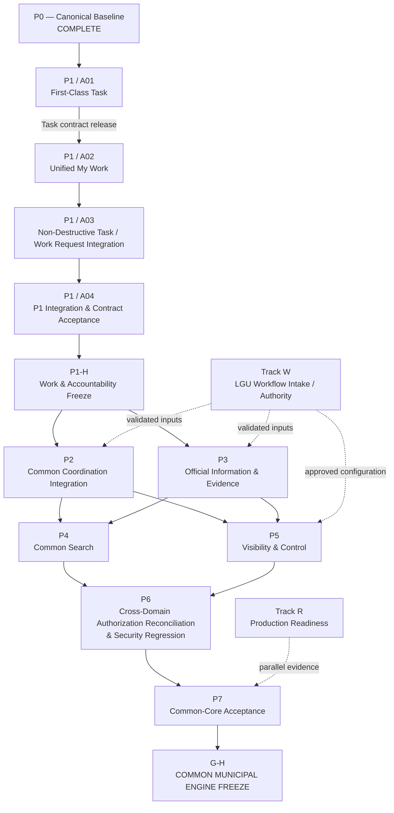
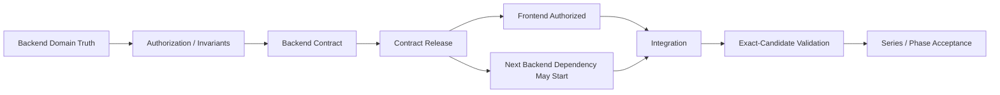

# KIRION FORGE MEMORY — COMMON PROGRAM DEPENDENCY GRAPH

## Program graph

---

# Hard dependencies

Hard:

`P0 -> A01 -> A02 -> A03/A04 -> P1-H`

Reason:

- generic Task is the missing source domain;
- true Unified My Work cannot include Task until Task contract exists;
- non-destructive integration cannot be accepted until Task + My Work contracts exist.

Other hard rules:

- P4 may not expose an unaccepted source domain;
- P6 final reconciliation must include the actual domains promoted into the common release candidate;
- P7 cannot freeze a capability that has not passed its own accepted contract.

---

# Soft/program-order dependencies

P2 and P3 are sibling maturation/integration areas after P1.

They may overlap if:

- consumed P1 contracts are stable;
- file/domain ownership is bounded;
- no unresolved authority dependency is being invented.

P4 and P5 may overlap after relevant source contracts are available.

Do not interpret the graph as:

`NO P3 UNTIL ALL P2 IS COMPLETE`

or:

`NO P5 UNTIL ALL P4 IS COMPLETE`

Instead:

`NO DOWNSTREAM WORK UNTIL ITS ACTUAL CONSUMED CONTRACT IS RELEASED`

---

# Contract-release gate model

---

# Dependency classes

Every dependency in the Engineering Hub must be labeled:

- `HARD-ENGINEERING`
- `SOFT-ENGINEERING`
- `MUNICIPAL-AUTHORITY`
- `DATA/CONFIGURATION`
- `PRODUCTION/PLATFORM`
- `EXTERNAL-INTEGRATION`

Unknown dependency type:

`STOP / CLASSIFY BEFORE SCHEDULING`
